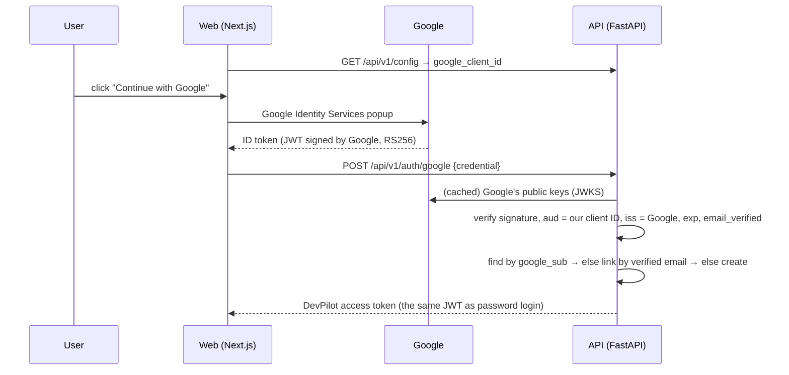

# Sign in with Google — design and setup

Added 2026-11-23 (an approved addition outside [PLAN.md](PLAN.md)'s phases). Code:
[`app/integrations/google.py`](../apps/api/app/integrations/google.py) (token verification),
[`app/services/google_auth.py`](../apps/api/app/services/google_auth.py) (account lookup /
linking), `POST /api/v1/auth/google` in [`app/api/auth.py`](../apps/api/app/api/auth.py), and
[`components/GoogleSignIn.tsx`](../apps/web/components/GoogleSignIn.tsx). Tests:
[`tests/test_google_auth.py`](../apps/api/tests/test_google_auth.py).

## The flow

## Decisions, and why

1. **The API verifies the token itself.** The browser's word is never trusted: the API checks
   Google's RS256 signature against Google's published keys, that `aud` is *our* client ID (a
   token Google issued to another website is useless here), that `iss` is Google, and the
   expiry. Only `RS256` is accepted, which blocks algorithm-confusion tricks (tested).
2. **One session system.** Google proves identity once; after that the user holds the same
   DevPilot JWT as a password user. So `token_version` (logout-everywhere on password reset),
   the 401 handling and every protected route work unchanged.
   - Why not NextAuth/Auth.js? It would add a second session (a Next.js cookie) next to the API's
     JWT, and the API would still have to verify *something*. Verifying Google's ID token in the
     API keeps one source of truth.
3. **No client secret.** ID-token sign-in uses only the public client ID. There's no
   authorization-code exchange, so there is no secret to leak.
4. **Accounts are keyed by Google's `sub`, not the email.** Email addresses can change; `sub`
   never does. `users.google_sub` is unique.
5. **Linking an existing account requires `email_verified`.** If someone already registered with
   a password, signing in with Google for the same *verified* address links the two. That's the
   same proof of ownership the forgot-password email relies on. If an address is already linked
   to a *different* Google account, the API refuses rather than re-linking it silently.
6. **New Google users get an unusable random password.** They can set one later with
   "Forgot password?".
7. **One failure message.** Every failure (forged, expired, wrong audience, unverified, inactive)
   returns the same `401`. The reason goes to the audit log (`user.login.failed`, `google: …`).
8. **Showcase mode.** `/auth/google` is allowed on the read-only showcase. A Google account
   there sees the recorded runs, exactly like the demo user, and can't change anything (the
   middleware refuses writes). The shared `demo@devpilot.dev` account can't be claimed through
   Google.

## Setup (Google Cloud Console, free)

1. <https://console.cloud.google.com/> → create a project (e.g. "DevPilot").
2. **APIs & Services → OAuth consent screen**: user type *External*, app name *DevPilot*, your
   support email. Scopes: the defaults (`openid`, `email`, `profile`). Publish the app (or add
   test users while it's in *Testing*).
3. **APIs & Services → Credentials → Create credentials → OAuth client ID** → *Web
   application*. **Authorized JavaScript origins**:
   - `http://localhost:3000` (local)
   - `https://devpilot-pied.vercel.app` (your Vercel URL)

   No redirect URIs are needed (popup mode).
4. Copy the **Client ID** (`…apps.googleusercontent.com`) and set `GOOGLE_CLIENT_ID` on the
   API: in `.env` locally, and in Render → devpilot-api → Environment for the live site. The web
   app reads it from `/api/v1/config`, so Vercel needs no change.

If the button says the origin isn't allowed, the site's exact URL (scheme, no trailing slash)
is missing from step 3.
